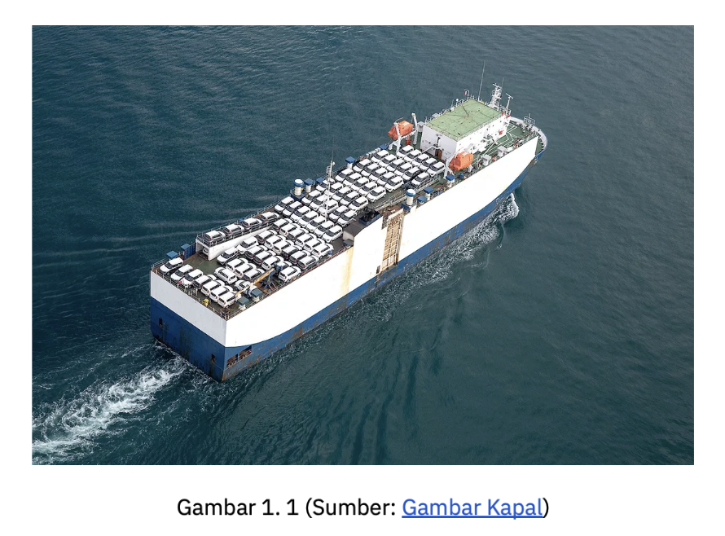
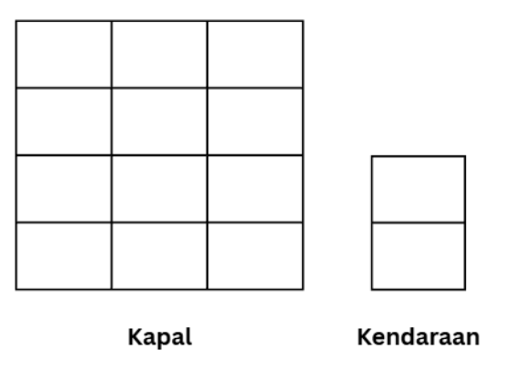

# IF3070_G18_Triplets

Tugas Besar 1 IF3070 Dasar Inteligensi Artifisial 2026/2027

Kelompok 18 Triplets, Institut Teknologi Bandung

Repository ini berisi implementasi enam algoritma local search, yaitu Steepest Ascent Hill-Climbing, Stochastic Hill-Climbing, Hill-Climbing with Sideways Move, Random Restart Hill-Climbing, Simulated Annealing, dan Genetic Algorithm. Keenam algoritma digunakan untuk menata kendaraan di geladak kapal kargo pada kasus satu kapal maupun multi-kapal, dengan objective function ShippingFee atau ETA.



*Sumber: Spesifikasi Tugas Besar 1 IF3070*

## Deskripsi Tugas Besar

Penataan kendaraan di geladak kapal kargo perlu memperhatikan luas geladak dan kapasitas berat kapal. Setiap kendaraan memiliki ukuran, berat, ShippingFee, dan ETA yang berbeda, sehingga tidak semua kendaraan dapat diangkut. Program ini menentukan kendaraan mana yang dimuat beserta posisi dan orientasinya agar total ShippingFee setinggi mungkin.

Geladak kapal dan kendaraan direpresentasikan sebagai grid dua dimensi. Suatu susunan dianggap valid apabila kendaraan tidak saling bertumpuk, seluruh bagian kendaraan berada di dalam geladak, dan total berat kendaraan tidak melebihi kapasitas kapal. Pencarian dimulai dari state acak, lalu susunan baru dibentuk dengan menukar dua kendaraan, memindahkan kendaraan, atau mengubah orientasi kendaraan.



*Sumber: Spesifikasi Tugas Besar 1 IF3070*

## Persiapan dan Program Demo

Program ditulis dengan Python 3 dan sudah diuji pada Python 3.13. Library tambahan yang digunakan hanya matplotlib untuk membuat gambar kapal dan grafik. Pada Windows, ganti `python3` dengan `python` di semua perintah.

1. Clone repository lalu masuk ke folder repository.

    ```bash
    git clone https://github.com/tiaracli/IF3070_G18_Triplets.git
    cd IF3070_G18_Triplets
    ```

2. Install library yang dibutuhkan.

    ```bash
    python3 -m pip install -r requirements.txt
    ```

3. Jalankan program demo.

    ```bash
    python3 src/main.py
    ```

4. Pilih kasus, yaitu kasus satu kapal atau kasus multi-kapal.

5. Pilih algoritma yang ingin dijalankan.

    | Nomor | Algoritma |
    | --- | --- |
    | 1 | Steepest Ascent Hill Climbing |
    | 2 | Stochastic Hill Climbing |
    | 3 | Sideways Move Hill Climbing |
    | 4 | Random Restart Hill Climbing |
    | 5 | Simulated Annealing |
    | 6 | Genetic Algorithm |

6. Pilih objective function, yaitu ShippingFee atau ETA.

7. Isi seed dan parameter algoritma. Setiap pertanyaan menampilkan batas angka yang boleh diisi, dan jika langsung menekan Enter, program menggunakan nilai bawaan.

8. Lihat hasilnya di terminal. Program menampilkan state awal dan akhir dalam bentuk grid, daftar kendaraan yang tidak terangkut, nilai ShippingFee, nilai ETA, jumlah iterasi, dan durasi pencarian.

9. Buka visualisasi jika diperlukan. Gambar state awal, state akhir, dan grafik disimpan otomatis ke folder `output/hc`, `output/sa`, atau `output/ga` sesuai algoritma yang dipilih.

## Menjalankan Eksperimen

Setiap algoritma memiliki file Python tersendiri untuk menjalankan seluruh percobaan dengan seed yang tetap.

| File Python | Isi | Folder hasil |
| --- | --- | --- |
| `src/run_hill_climbing.py` | Keempat varian Hill-Climbing dengan objective ShippingFee dan ETA | `output/hc` dan `output/bonus_eta` |
| `src/run_sa.py` | Simulated Annealing pada kasus satu kapal dan multi-kapal | `output/sa` |
| `src/run_geneticalgorithm.py` | Genetic Algorithm dengan variasi iterasi dan populasi, ditambah eksperimen bonus | `output/ga` |
| `src/run_visual.py` | Gambar dan grafik Hill-Climbing serta Simulated Annealing dari hasil eksperimen | `output/hc`, `output/bonus_eta`, dan `output/sa` |

Contoh menjalankannya adalah `python3 src/run_sa.py`. File `run_visual.py` membaca hasil eksperimen dalam bentuk JSON, sehingga `run_hill_climbing.py` dan `run_sa.py` perlu dijalankan terlebih dahulu. Karena seed-nya tetap, nilai yang dihasilkan akan selalu sama, sedangkan durasinya dapat sedikit berbeda tergantung perangkat.

## Dataset

Dataset dibuat menggunakan `src/data/make_data.py` dan disimpan dalam format JSON di folder `src/data`.

| File | Kapal | Jumlah kendaraan tersedia | Kegunaan |
| --- | --- | --- | --- |
| `kasus_1.json` | 1 kapal 8 × 8, kapasitas 22 | 13 | Pengujian utama |
| `kasus_multi.json` | 2 kapal, 8 × 8 kapasitas 22 dan 6 × 8 kapasitas 16 | 20 | Pengujian bonus multi-kapal |

Jumlah kendaraan pada tabel merupakan seluruh kendaraan yang tersedia untuk dipilih, bukan jumlah kendaraan yang pasti terangkut, karena total berat dan luasnya melebihi kapasitas kapal. Kendaraan terdiri atas empat jenis, yaitu motor, sedan, SUV, dan truk, dengan atribut id, lebar, panjang, berat, ShippingFee, dan ETA.

## Representasi State

- State disimpan dalam bentuk tuple yang panjangnya sama dengan jumlah kendaraan, dengan satu isi untuk setiap kendaraan.
- Setiap isi tuple berbentuk `(ship_idx, x, y, orientation)`, yaitu nomor kapal dan koordinat pojok kendaraan pada grid.
- Orientasi `H` berarti kendaraan diletakkan sesuai ukuran aslinya, sedangkan `V` berarti kendaraan diputar.
- Kendaraan yang tidak diangkut ditulis sebagai `(-1, 0, 0, "H")`, sehingga tetap tercatat walaupun berada di luar kapal.
- Nomor kapal ikut disimpan di setiap kendaraan, sehingga bentuk state yang sama dapat langsung digunakan untuk kasus multi-kapal.
- Setiap state baru diperiksa oleh fungsi `cek_placement`, sehingga semua state yang diproses sudah pasti valid.

## Objective Function

1. ShippingFee, yaitu memaksimalkan total ShippingFee dari seluruh kendaraan yang diangkut.
2. ETA (bonus), yaitu total ShippingFee yang dikurangi setengahnya untuk kendaraan dengan ETA paling lama 3 hari yang diletakkan jauh dari pintu masuk, sehingga kendaraan yang harus cepat diturunkan cenderung ditempatkan di dekat pintu masuk.

## Struktur File Repository

```
IF3070_G18_Triplets/
├── docs/
│   └── img/
├── output/
│   ├── hc/
│   ├── bonus_eta/
│   ├── sa/
│   └── ga/
├── src/
│   ├── data/
│   │   ├── kasus_1.json
│   │   ├── kasus_multi.json
│   │   └── make_data.py
│   ├── core.py
│   ├── neighbor.py
│   ├── hill_climbing.py
│   ├── sa.py
│   ├── geneticalgorithm.py
│   ├── data_io.py
│   ├── visual.py
│   ├── main.py
│   ├── run_hill_climbing.py
│   ├── run_sa.py
│   ├── run_geneticalgorithm.py
│   └── run_visual.py
├── requirements.txt
└── README.md
```

## Pembagian Tugas

| Nama | NIM | Tugas |
| --- | --- | --- |
| Indah Ramadhani | 18224037 | • Pemeriksaan constraint dan objective function<br>• Implementasi dan eksperimen keempat varian Hill-Climbing<br>• Bonus objective function ETA<br>• Laporan BAB I, subbab BAB II 2.1.3, 2.2, 2.4, BAB III 3.1, dan 3.2 |
| Tiara Clianta Andiwi | 18224078 | • Pembentukan initial state dan neighbor<br>• Implementasi dan eksperimen Simulated Annealing<br>• Bonus multi-kapal<br>• Laporan subbab BAB II 2.1.2, 2.1.4, 2.5, dan BAB III 3.3<br>• Form Penggunaan Generative AI |
| Salsabila Shofiyah | 18224088 | • Dataset<br>• Implementasi dan eksperimen Genetic Algorithm<br>• Visualisasi semua algoritma<br>• Program demo `main.py`<br>• README dan release<br>• Laporan BAB II subbab 2.1.1, 2.3, 2.6, 2.7, 2.8, BAB IV, dan BAB V |